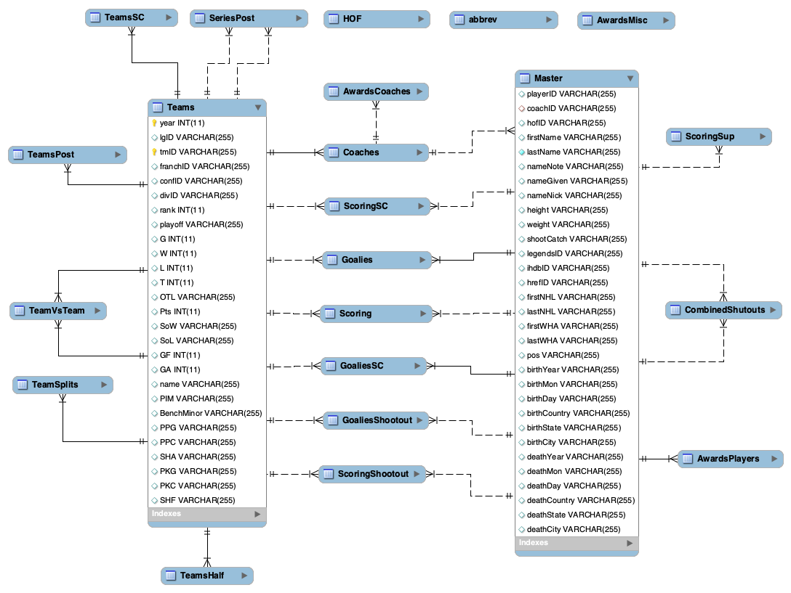
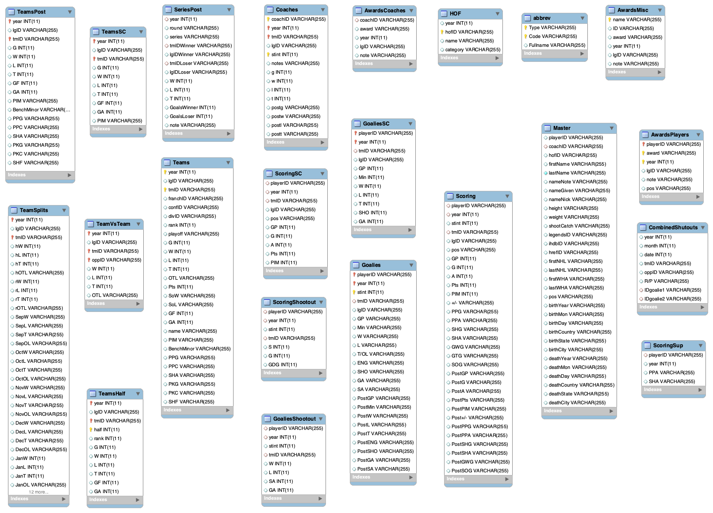

Ice hockey, known simply as hockey in North America and parts of Europe, is a team sport played on an ice rink in which two opposing teams use sticks to control and shoot a puck into the opponent's net. Each team fields six players on the ice at a time, including a goaltender. The team with the highest score after an hour of gameplay is declared the winner; ties are broken in overtime or a shootout. It is a full contact game and one of the more physically demanding team sports.

Ice hockey seasons in North America are divided into two main phases. First, teams compete in a regular season within their respective divisions and conferences to accumulate points and secure the highest possible standing. At the end of the regular season, a fixed number of top-performing teams qualify for the postseason playoffs, where they compete in elimination series to win the championship trophy.

Using the historical ice hockey data provided in this assignment, the goal is to develop machine learning models to predict the following for the target test season:

- (a) The final regular season ranking of teams
- (b) The set of teams that will change coaches
- (c) TBA (to be announced)

For all project questions, you should assume that the day you are making the predictions is the day before the first game of a new season. The predictions are for that new season starting tomorrow.

## Data description

### Database Entity-Relationship Diagram (Entities and Relationships)

### Database Entity-Relationship Diagram (Entities and Attributes)

The **relational database** comprises several **tables** detailing individual, team, and playoff performances:

- **Master**: Biographical details and career attributes for all players and coaches (e.g., height, weight, shooting/catching hand, debut/retirement years)
- **Scoring**: Player performance metrics (e.g., games played, goals, assists, penalty minutes)
- **Goalies**: Goaltender performance metrics (e.g., minutes played, wins, losses, goals against, saves/shots faced, shutouts)
- **Coaches**: Coaching statistics (e.g., games coached, wins, losses, ties, postseason performance)
- **Teams**: Team-level seasonal aggregates, standings, goal statistics, and playoff qualification status
- **TeamsHalf**: First half / second half standings
- **TeamSplits**: Team home/road performance metrics and monthly splits
- **TeamVsTeam**: Head-to-head records
- **ScoringShootout**: Individual performance metrics in shootouts
- **GoaliesShootout**: Goaltender performance metrics in shootouts
- **CombinedShutouts**: Logs of combined shutouts, recording the team, opponent, and involved goaltenders.
- **SeriesPost**: Outcome records (e.g., winning team, losing team, games won/lost) for the postseason playoff series
- **TeamsPost**: Team-level performance stats for the postseason playoff series
- **ScoringSC**: Player performance metrics in Stanley Cup finals
- **GoaliesSC**: Goaltender performance metrics in Stanley Cup finals
- **TeamsSC**: Team-level performance stats in Stanley Cup finals
- **AwardsPlayers**: Player awards, trophies, postseason all-star teams
- **AwardsCoaches**: Coaches awards, trophies, postseason all-star teams
- **AwardsMisc**: Miscellaneous awards
- **abbrev**: Abbreviations used in Teams and SeriesPost tables
- **HOF**: Hall of Fame information
- **ScoringSup**: Supplemental scoring statistics

## Glossary

- playerID: Player ID
- coachID: Coach ID
- hofID: Hall of Fame ID
- legendsID: ID at Legends Of Hockey (www.legendsofhockey.net)
- ihdbID: ID at the Internet Hockey Database
- hrefID: ID at Hockey-Reference.com
- tmID: Team ID
- lgID: League ID
- franchID: Franchise ID
- confID: Conference ID
- divID: Division ID
- firstNHL: First NHL season (2005-06 listed as "2005")
- shootCatch: Shooting hand (catching hand for goalies)
- pos: Position
- stint: order of appearance in a season
- GP: Games played
- G: Goals scored
  - Note: except in the "Coaches" and some team-related tables (i.e., "Teams", "TeamsHalf", "TeamsPost", and "TeamsSC" tables), where it stands for "Games"
- A: Assists
- Pts: Points
- PIM: Penalty minutes
- PPG / PPA: Power play goals / Power play assists
- SHG / SHA: Short-handed goals / Short-handed assists
- W: Wins
- L: Losses
- T/OL: Ties / Overtime losses
- ENG: Empty net goals
- SHO: Shutouts
- GA / SA: Goals against / Shots against
- OTL: Overtime losses
- SoW / SoL: Shootout wins / Shootout losses
- SHF: Shorthanded goals for
- hW / rW: Home wins / Road wins
- JanW / JanL / JanT / JanOL: January wins / losses / ties / overtime losses
- R/P: "R" for regular season, or "P" for postseason
- GDG: Game-deciding goals
- S: Shots

**NOTE:** This is not an exhaustive list; the remainder is part of the data understanding
